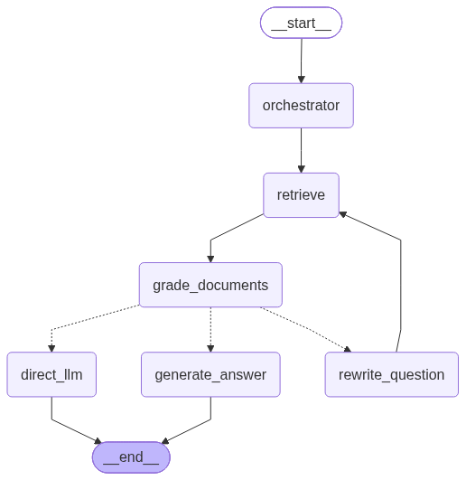

# End-to-End Agentic Science RAG

A portfolio project for answering questions from science textbook PDFs with Streamlit, FastAPI, LangGraph, ChromaDB, Hugging Face embeddings and Groq-hosted LLMs. No SQLite is used.

## Features
- Streamlit sidebar with three configurable Groq model choices and a password-style API-key input.
- FastAPI endpoints for questions, model options and human feedback.
- LangGraph workflow: `orchestrator → retrieve → grade_documents → generate_answer` or `rewrite_question → retrieve` with bounded retries, then direct-LLM fallback.
- Binary relevance grading (`yes` / `no`) per retrieved chunk.
- PDF-based answer generation uses the original question and relevant PDF excerpts; source filename/page details are returned when available.
- Fallback is labelled as not grounded in the PDF database.
- Accepted / Rejected feedback stored in local JSONL files, not SQLite. API keys are never written to logs.

## Project Structure

```
D:\End_to_End_Agentic_RAG\
├── app.py                   # Streamlit Frontend Runner
├── api.py                   # FastAPI Backend Entry Point        
├── requirements.txt         # Project Dependencies
├── README.md                # Project Documentation
├── data/
│   ├── pdfs/                # Place your source PDFs here (Git-ignored)
│   ├── chroma/              # Vector database storage (Git-ignored)
│   ├── answers.jsonl        # Local answer audit logs
│   └── feedback.jsonl       # User feedback logs
└── src/
    └── langgraphagenticai/
        ├── config.py
        ├── LLMS/groqllm.py
        ├── api/{routes.py, schemas.py}
        ├── graph/graph_builder.py
        ├── nodes/nodes.py
        ├── state/state.py
        ├── vectorstore/{store.py, ingest.py}
        └── ui/streamlitui/loadui.py

'''
##  Workflow Architecture



## Windows / VS Code setup
1. Install Python 3.12.
2. In the repository root:
   ```powershell
   py -3.12 -m venv .venv
   .\.venv\Scripts\Activate.ps1
   python -m pip install --upgrade pip
   pip install -r requirements.txt
   ```
3. Put your own PDF(s) in `data/pdfs/`.


4. Build the index:
   ```powershell
   python -m src.langgraphagenticai.vectorstore.ingest
   ```
   The first run downloads the embedding model. Re-ingestion rebuilds `data/chroma/`.
5. Terminal 1 — start FastAPI:
   ```powershell
    uvicorn api:app --reload --port 8000 
   ```
   API docs: http://127.0.0.1:8000/docs
6. Terminal 2 — start Streamlit:
   ```powershell
   streamlit run app.py
   ```
7. Enter your Groq key in the UI sidebar and select a model. Check Groq Console if model IDs have changed or are unavailable for your account.

## API endpoints
- `GET /health`
- `GET /api/v1/models`
- `POST /api/v1/ask` with `question`, `api_key`, and `model_id`
- `POST /api/v1/feedback` with `answer_id`, `rating` (`accepted`/`rejected`), and optional `comment`
- `GET /api/v1/feedback/stats`

## Workflow
1. Orchestrator turns the original question into a retrieval query.
2. ChromaDB retrieves the top matching chunks.
3. The grader classifies each chunk as `yes` or `no` against the original question.
4. If any chunk is relevant, `generate_answer` answers from the original question and relevant PDF context only.
5. If none is relevant, `rewrite_question` updates the retrieval query and retries. `MAX_REWRITES` is configured in `config.py`.
6. If all attempts fail, the direct LLM fallback answers from general model knowledge and is clearly labelled as not PDF-grounded.
7. The user can submit Accepted / Rejected feedback.


## Storage and security notes
`data/answers.jsonl` and `data/feedback.jsonl` are append-only local logs, not a database, and are ignored by Git. This is suitable for a local single-process demo, not a multi-worker production deployment. Never expose the development server publicly or use a real key on an untrusted host. The key is passed from the UI to FastAPI for the request and is not persisted by this code.

## Troubleshooting Common Issues
1. ERROR_CONNECTION_REFUSED / API connection failure: Ensure that your FastAPI backend is actively running on port 8000 (http://127.0.0.1:8000) before clicking "Get Answer" in the Streamlit UI.

2. NotFoundError from Groq: Verify your selected model name in the sidebar dropdown or check your Groq Console account limits and model deprecations.

## Author
Name: NARENDRA SINGH
